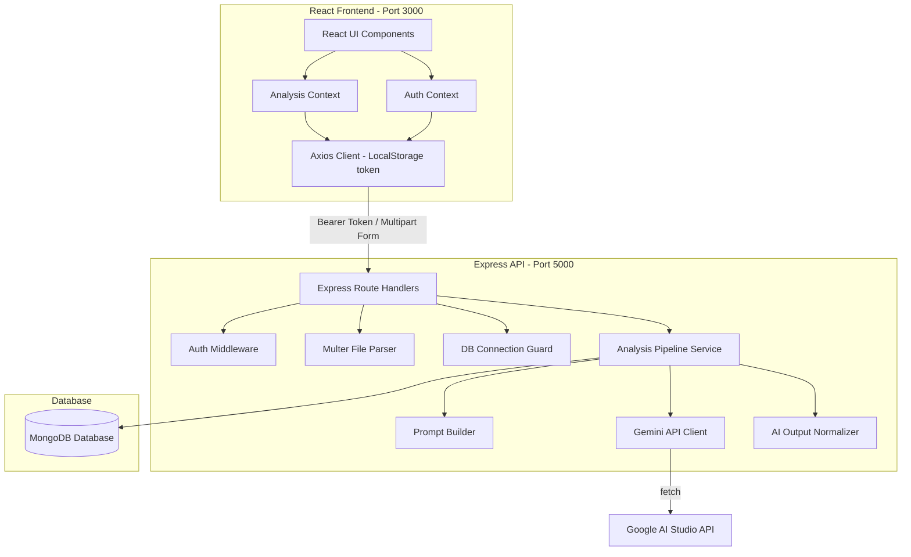

# RootCause AI — Full Project Report & System Documentation

An AI-powered SaaS bug analysis platform designed for modern development workflows. RootCause AI parses application traces, console logs, and source code files to automate root cause analysis, reproduction step synthesis, and source code patches using Google Gemini.

---

## 1. Executive Summary

### The Problem
Production bug investigation is a time-consuming developer task. When an exception occurs, engineers must manually correlate stack traces, environment variables, database metrics, and application source code to identify the line of failure and write a patch.

### The Solution
RootCause AI automates this workflow. Developers upload log files and affected source code. The platform applies a strict reasoning pipeline (**Input Evidence → Contextual Analysis → Evidence-Backed Conclusion**) to deliver structured analysis reports, interactive checklists, and drop-in code diffs in seconds.

---

## 2. Key Product Features

*   **Evidence-Backed Analysis**: Enforces logical constraints on the LLM, ensuring that all conclusions are derived directly from the uploaded stack traces and log evidence.
*   **Source Code Presence Guard**: The backend analysis pipeline validates uploaded files. If no source code is supplied, it aborts analysis immediately and displays:
    > *"you have not uploaded any source code . please try again after uploading require code files"*
*   **Interactive Fix Checklists**: Generates practical, step-by-step fix tasks that developers can track, check off, and persist to the database.
*   **Bearer Token Authentication**: Safe session management using JWT Bearer headers, resolving cross-port browser cookie issues during local development and deployment.
*   **Real-time Notifications**: Background completion alerts and severity warnings triggered directly on report generation.
*   **Resilient JSON Parsing**: Intercepts, strips, and cleans LLM outputs (including markdown backtick blocks and malformed structures) to prevent JSON parsing crashes.

---

## 3. System Architecture & Component Design

The platform uses a decoupled client-server architecture with a React single-page application (SPA) fronting a RESTful Express API backed by MongoDB.



---

## 4. Database Models & Schema Design (Mongoose)

### 4.1. User Model (`User.ts`)
Stores registration data and developer profiles.
```typescript
{
  name: { type: String, required: true },
  email: { type: String, required: true, unique: true, index: true, lowercase: true, trim: true },
  password: { type: String, required: true },
  role: { type: String, default: 'User' },
  avatarUrl: { type: String },
  organization: { type: String }
}
```

### 4.2. Analysis Model (`Analysis.ts`)
Stores the full analysis metadata, uploaded files, and AI-generated content.
```typescript
{
  userId: { type: String, required: true, index: true },
  title: { type: String, required: true },
  description: { type: String },
  status: { type: String, enum: ['processing', 'completed', 'failed'], default: 'processing', index: true },
  uploadedFiles: [{
    id: String,
    name: String,
    size: String,
    category: String,
    contentSnippet: String
  }],
  bugSummary: [String],
  summary: { type: String },
  reproductionSteps: [String],
  rootCauseAnalysis: [String],
  confidenceScore: Number,
  confidenceReasoning: String,
  suggestedFiles: [{
    name: String,
    path: String,
    language: String,
    originalCode: String,
    fixedCode: String,
    explanation: String
  }],
  fixRecommendations: [{
    id: String,
    text: String,
    completed: Boolean,
    category: String
  }],
  severity: { type: String, index: true },
  priority: String,
  severityReason: String,
  failureReason: String,
  environmentDetails: {
    browser: String,
    os: String,
    runtime: String,
    version: String
  }
}
```

---

## 5. API Reference & Contract Design

### 5.1. Authentication APIs
*   `POST /api/auth/register` - Creates a pending user and dispatches a 6-digit OTP verification code.
*   `POST /api/auth/register/verify` - Validates the OTP code, registers the user, and returns the JWT Bearer token.
*   `POST /api/auth/login` - Authenticates user credentials and returns the Bearer token.
*   `GET /api/auth/me` - Verifies the Bearer token in the `Authorization` header and returns user metadata.

### 5.2. Analysis APIs
*   `GET /api/analyses` - Returns user-specific analyses. Supports search, severity filters, and sorting.
*   `POST /api/analyses` - Accepts code files and logs (multipart), validates presence of source files, queries Gemini, and creates the report.
*   `GET /api/analyses/:id` - Retrieves individual analysis records.
*   `DELETE /api/analyses/:id` - Removes analysis records.
*   `PATCH /api/analyses/:id/checklist/:recId` - Toggles checkboxes for recommendations.

---

## 6. Implementation History & Refactoring Log

### 6.1. Resolving CORS and Auth Header Issues
*   **Original Code**: Utilized HTTP-only session cookies.
*   **Issue**: During local development, the Vite dev server ran on port `3000` while the backend ran on port `5000`. The browser blocked the cookie exchange across ports, causing all requests after login to fail with `401 Unauthorized`.
*   **Refactor**: Shifted JWT storage from cookies to local storage Bearer tokens. Updated frontend Axios headers via interceptors to append `Authorization: Bearer <token>` to all outgoing requests. Added explicit CORS handling for `http://localhost:3000`.

### 6.2. Deprecated Model and Dynamic Env Keys
*   **Original Code**: Targeted `gemini-1.5-flash` at module-import time.
*   **Issue**: The model name was deprecated, causing `404 NOT_FOUND` errors. Furthermore, the API key was evaluated at startup before `dotenv` completed execution, leaving it blank.
*   **Refactor**: Updated model targeting to `gemini-3.5-flash`. Modified `geminiService.ts` to read env keys dynamically inside the request handler, ensuring values are loaded successfully.

### 6.3. Bulletproof JSON Formatting & Error Recoveries
*   **Original Code**: Used a rigid, strict array validator that crashed with 500 errors if Gemini returned different keys, summary strings, or fewer suggested files.
*   **Refactor**: Implemented a normalization validator inside `aiOutputValidator.ts`. It maps alternate response fields (like string `summary` to array `bugSummary`), strips markdown backtick blocks (```json ... ```), and pads empty lists to ensure valid document structures.

### 6.4. Severity Rendering Crash Fix
*   **Original Code**: Frontend badge styles mapped only `HIGH`, `MEDIUM`, and `LOW` severities.
*   **Issue**: When the backend saved high-severity bugs as `CRITICAL`, the React component crashed because `styles.bg` became undefined.
*   **Refactor**: Expanded frontend type signatures to include `CRITICAL`, added corresponding Tailwind badge colors, and added a safe fallback style.

---

## 7. Getting Started

### 7.1. Setup Dependencies
From the project root directory, run:
```bash
npm install
npm --prefix backend install
npm --prefix frontend install
```

### 7.2. Seed Default Account
Generate the test credentials directly into your MongoDB collection:
```bash
node backend/seed.mjs
```

### 7.3. Run Dev Server
```bash
npm run dev:all
```
Visit `http://localhost:3000` to access the application.

---

## 🔑 Seeded Credentials
For instant access during development:
*   **Email**: `email123@gmail.com`
*   **Password**: `password123`
  